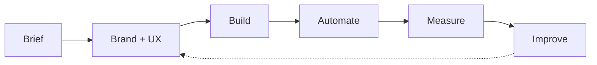

<div align="center">




<a href="https://mr-gfx.com"></a>
<a href="https://www.linkedin.com/in/mohamedreda-gfx/"></a>
<a href="https://mr-gfx.com/en/book"></a>
<a href="mailto:hello@mr-gfx.com"></a>

<br /><br />


</div>



## 👋 Who I am

I'm **Mohamed Reda**, the person behind **MR GFX**: a brand-and-engineering practice that takes an idea from identity to a live, measured product. Design, code, marketing and automation sit under one roof, so nothing gets lost between teams.

```ts
const mohamed = {
  brand:   "MR GFX",
  base:    "Kuwait · working across the Gulf and Egypt",
  languages: ["العربية", "English"],
  craft:   ["brand systems", "web apps", "dashboards", "AI workflows", "bots", "growth"],
  rule:    "Design the experience. Engineer the system. Measure the result.",
};
```


## 🧩 What I build

<table>
<tr>
<td width="33%" valign="top">

### 🎨 Brand &amp; creative
Identity systems, landing pages, social and campaign creative, AI-assisted video. Built to be remembered, then measured.

</td>
<td width="33%" valign="top">

### ⚙️ Product engineering
Next.js and React front ends, Node.js APIs, Supabase / Postgres with row-level security, admin panels, bilingual RTL interfaces.

</td>
<td width="33%" valign="top">

### 🤖 Automation &amp; growth
Telegram bots, booking and reminder flows, AI content pipelines, SEO and GEO, performance marketing tied to real numbers.

</td>
</tr>
</table>


## 🛠 Toolbox

<div align="center">


<br /><br />


</div>


## 🚀 Things I've shipped

| Project | What it is |
| --- | --- |
| [**mr-gfx.com**](https://mr-gfx.com) | This portfolio. Next.js, bilingual AR/EN with RTL, static generation, a booking system with reminders, and an admin app. Accessibility and performance tested. |
| [**Mashhor Hub**](https://mashhor-hub.com) | Growth engine and platform for Gulf brands. |
| [**Work Zone**](https://zone.mashhor-hub.com) | Team work and task management. |
| [**Mashhor AI**](https://mashhor.io) | AI tooling for business workflows. |
| [**Munjiz**](https://munjiz-eg.com) | Productized service built for the Egyptian market. |

Client work stays private by default. If we collaborate, relevant case studies are shared on request.


## 🧭 How I work



- **Small, safe, shippable.** Production-ready steps over noisy rewrites.
- **Every state designed.** Loading, empty, error, success, and the edge cases between.
- **Secure by default.** Row-level security, signed links, rate limits, no secrets in code.
- **Honest numbers.** No invented metrics, no decorative claims.


<div align="center">

### Have something worth building?

<a href="https://mr-gfx.com/en/book"></a>
<a href="https://mr-gfx.com/ar"></a>

</div>
