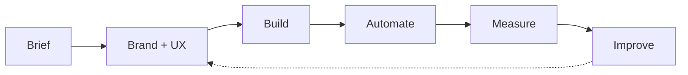

<div align="center">


<a href="https://mr-gfx.com"></a>
<a href="https://www.linkedin.com/in/mohamedreda-gfx/"></a>
<a href="https://mr-gfx.com/en/book"></a>
<a href="mailto:hello@mr-gfx.com"></a>

<br /><br />


</div>


## 👋 Who I am

I'm **Mohamed Reda**, the person behind **MR GFX**: a brand-and-engineering practice that takes an idea from identity to a live, measured product. Design, code, marketing and automation sit under one roof, so nothing gets lost between teams.

```ts
const mohamed = {
  brand:   "MR GFX",
  base:    "Kuwait · working across the Gulf and Egypt",
  languages: ["العربية", "English"],
  craft:   ["brand systems", "web apps", "dashboards", "AI workflows", "bots", "growth"],
  rule:    "Design the experience. Engineer the system. Measure the result.",
};
```


## 🧩 What I build

<table>
<tr>
<td width="33%" valign="top">

### 🎨 Brand &amp; creative
Identity systems, landing pages, social and campaign creative, AI-assisted video. Built to be remembered, then measured.

</td>
<td width="33%" valign="top">

### ⚙️ Product engineering
Next.js and React front ends, Node.js APIs, Supabase / Postgres with row-level security, admin panels, bilingual RTL interfaces.

</td>
<td width="33%" valign="top">

### 🤖 Automation &amp; growth
Telegram bots, booking and reminder flows, AI content pipelines, SEO and GEO, performance marketing tied to real numbers.

</td>
</tr>
</table>


## 🧭 Experience

<div align="center">

</div>

Ten years, one layer at a time: media, design, social and agencies, marketing, then products and AI. I learned each layer by doing it, so I know how the pieces fit.


## 🧠 Skills

<div align="center">

</div>


## 🧰 Platforms &amp; tools

<div align="center">

</div>


## 💻 How I code

I build with AI in the loop (vibe coding), then hold the result to an engineering bar: types, tests, security and performance. Speed comes from the tools, trust comes from the checks.

```ts
const howIBuild = {
  stack: {
    web:      ["Next.js", "React", "TypeScript", "Tailwind CSS", "next-intl (AR/EN, RTL)"],
    backend:  ["Node.js", "Express", "Python", "PostgreSQL (Supabase, RLS)", "SQLite"],
    mobile:   ["Expo", "React Native"],
    ai:       ["Claude", "OpenAI", "Gemini", "Model Context Protocol"],
    quality:  ["Vitest", "Playwright", "axe", "Lighthouse"],
  },
  principles: [
    "every state designed: loading, empty, error, success",
    "secure by default: row-level security, signed links, rate limits",
    "bilingual from day one: Arabic RTL is not an afterthought",
    "measured: accessibility and performance are tested, not assumed",
  ],
  shipped: ["mr-gfx.com", "owner app (Expo)", "Mashhor Quran MCP", "Work Tracker Agent"],
} as const;
```


## 🎓 Certifications

<div align="center">

</div>

<div align="center"><a href="https://www.linkedin.com/in/mohamedreda-gfx/"></a></div>


## 🚀 Things I've shipped

| Project | What it is |
| --- | --- |
| [**mr-gfx.com**](https://mr-gfx.com) | This portfolio. Next.js, bilingual AR/EN with RTL, static generation, a booking system with reminders, and an owner app. Accessibility and performance tested. |
| [**Mashhor Hub**](https://mashhor-hub.com) | Influencer-marketing platform connecting GCC brands with talent. Founder and CEO: positioning, brand system, launch and campaign workflow. |
| [**Mashhor App**](https://mashhor-hub.com/app/) | An app for booking celebrities and influencers across the Arab world. |
| [**Mashhor AI**](https://mashhor.io) | AI-powered SaaS platform for influencer discovery, analytics and campaign management. |
| [**Work Zone**](https://zone.mashhor-hub.com) | AI-powered workspace for agencies, marketing firms and companies to manage and organise tasks. |
| [**Munjiz**](https://munjiz-eg.com) | Egyptian government-services e-platform built from zero: identity, website, communication flow and service offer. |

Client work stays private by default. If we collaborate, relevant case studies are shared on request.


## 🔁 How I work



- **Small, safe, shippable.** Production-ready steps over noisy rewrites.
- **Every state designed.** Loading, empty, error, success, and the edge cases between.
- **Secure by default.** Row-level security, signed links, rate limits, no secrets in code.
- **Honest numbers.** No invented metrics, no decorative claims.


<div align="center">

### Have something worth building?

<a href="https://mr-gfx.com/en/book"></a>
<a href="https://mr-gfx.com/ar"></a>

</div>
